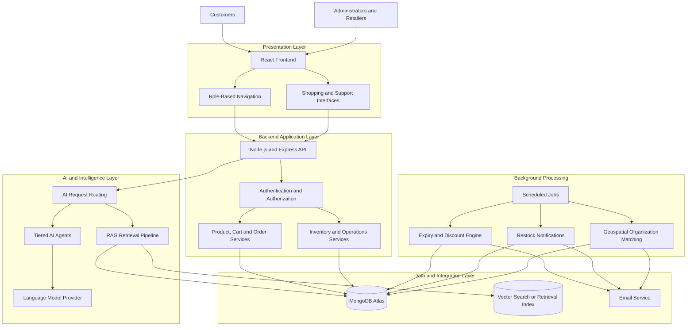
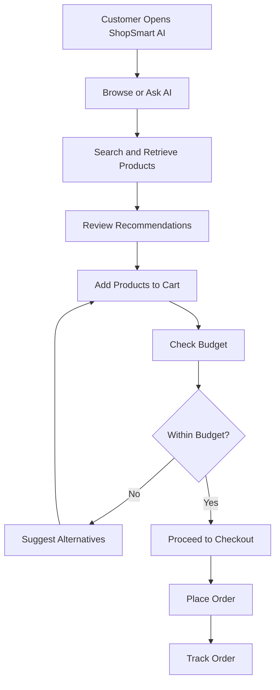
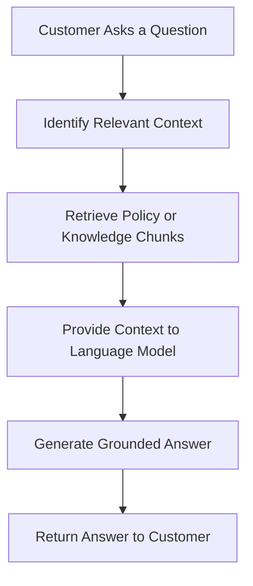
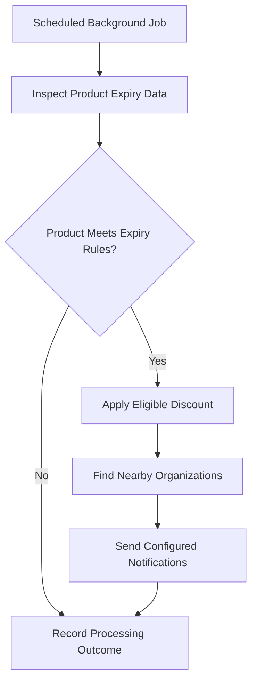

# 🛍️ ShopSmart AI
### Autonomous E-Commerce Assistant Platform | HCL Hackathon

## 🌐 Live Demo

**Try ShopSmart AI:** [https://shopsmart-ai-kvg6.onrender.com/orders](https://shopsmart-ai-kvg6.onrender.com/orders)

Explore the ShopSmart AI platform and its AI-powered shopping experience.

> Note: This URL points to the `/orders` route. If you want visitors to open the application's homepage, use the deployed frontend's root URL instead, if available.

**Built by Team MergeStrikes**

ShopSmart AI is an AI-powered e-commerce platform designed to make online shopping more personalized while helping retailers manage inventory, reduce product wastage, and automate everyday operations.

Unlike traditional e-commerce platforms, ShopSmart AI combines conversational shopping, tiered AI agents, RAG-based customer support, intelligent checkout assistance, and automated inventory management into a single platform.

Our goal is to create a smarter shopping experience for customers while helping businesses operate more efficiently and sustainably.

---

## 📌 Table of Contents

- [Problem Statement](#-problem-statement)
- [Our Solution](#-our-solution)
- [Unique Functionalities](#-unique-functionalities)
- [High-Level Design (HLD)](#-high-level-design-hld)
- [System Architecture](#-system-architecture)
- [Technology Stack](#-technology-stack)
- [Project Structure](#-project-structure)
- [Application Workflow](#-application-workflow)
- [Installation and Setup](#-installation-and-setup)
- [Environment Variables](#-environment-variables)
- [Future Enhancements](#-future-enhancements)
- [Team MergeStrikes](#-team-mergestrikes)

---

## 🚨 Problem Statement

Traditional e-commerce platforms face several challenges:

- **Discovery overload:** Customers struggle to find the right products among thousands of listings.
- **Limited personalization:** Product recommendations often fail to consider individual needs, preferences, and budgets.
- **Budget overruns:** Customers may add products to their cart without realizing that the total exceeds their budget.
- **Policy confusion:** Customers frequently struggle to understand return, refund, and warranty policies.
- **Inventory wastage:** Retailers lose revenue when perishable products approach their expiry dates.
- **Stock availability gaps:** Customers cannot easily track products that are currently out of stock.
- **Operational inefficiency:** Inventory monitoring, promotions, and customer notifications often require manual intervention.

## 💡 Our Solution

ShopSmart AI introduces an autonomous shopping and retail assistance platform that connects customer-facing AI capabilities with backend operational automation.

The platform enables customers to discover products using natural language, receive personalized recommendations, stay within budget, resolve order-related questions, and track deliveries.

At the same time, retailers can monitor inventory, manage promotions, receive stock insights, and automate expiry-related actions.

Our solution combines AI-driven decision support with conventional backend services to provide a practical, scalable e-commerce experience.

---

## ✨ Unique Functionalities

### 1. 🗣️ Conversational Product Discovery

Customers can search for products using natural language instead of manually applying multiple filters.

**Example:**

> "Saste laptops dikhao under ₹50,000 with 16GB RAM."

The assistant interprets the customer's requirements and helps identify relevant products using product information, availability, budget, and specifications.

**Key capabilities:**
- Natural-language product search.
- English and Hinglish interaction.
- Budget- and specification-based discovery.
- Context-aware shopping assistance.
- Product availability checks.

**Why it is unique:** It transforms product discovery from a traditional filter-based process into a conversational shopping experience.

### 2. 🤖 Tiered AI Agent System

ShopSmart AI supports different levels of AI assistance based on the user's membership tier.

| Capability | Basic Tier | Premium Tier |
|---|---|---|
| Product discovery | Database-backed queries | AI-assisted personalized discovery |
| Availability checks | Supported | Supported |
| Personalized recommendations | Basic assistance | Advanced personalization |
| Body-type-based matching | Limited or unavailable | Supported for relevant products |
| Smart bundle discounts | Standard offers | Personalized bundle suggestions |

The tiered architecture helps align AI capabilities with membership benefits while allowing the application to use simpler backend operations when advanced orchestration is unnecessary.

### 3. 💰 AI-Powered Budget Guardian

The AI Checkout Assistant helps customers avoid exceeding their intended spending limit.

**Workflow:**
1. The customer adds products to the cart.
2. The assistant evaluates the cart total against the customer's budget.
3. If the total exceeds the budget, it identifies potential alternatives.
4. It suggests lower-cost products or changes that may help the customer stay within budget.

**Example:**

A customer has a budget of ₹10,000, but their cart total reaches ₹12,000. The assistant can suggest suitable, lower-priced alternatives.

**Why it is unique:** Instead of only displaying the final price, the platform actively assists customers in making budget-conscious purchasing decisions.

### 4. 📚 RAG-Powered Policy and Support Assistant

The support assistant uses Retrieval-Augmented Generation (RAG) to answer questions using relevant policy information and, where applicable, order-specific context.

**Supported use cases:**
- Return and refund policies.
- Warranty-related questions.
- Order-related support.
- Product-specific policy clarification.

**How it works:**
1. The customer submits a question.
2. The system retrieves relevant policy documents or knowledge chunks.
3. The retrieved information is provided to the language model as context.
4. The assistant generates an answer grounded in the retrieved information.

**Why it is unique:** The assistant is designed to use relevant source information instead of relying only on the language model's general knowledge.

### 5. 📦 Real-Time Order Tracking Assistant

Customers can ask conversational questions about their orders instead of navigating multiple pages.

**Example:**

> "Where is my order right now?"

The assistant retrieves available order information from the backend and presents the relevant delivery status.

This feature provides a more convenient interface for accessing order information.

### 6. ♻️ Smart Sustainability and Expiry Management

ShopSmart AI includes an automated expiry-management engine designed to reduce retail food wastage.

**Workflow:**
1. Background jobs periodically inspect product expiry information.
2. Products approaching expiry are identified according to configured rules.
3. Eligible products can receive automated discounts.
4. Nearby organizations that may be able to use unsold items can be identified.
5. The system can initiate email notifications based on the configured operational workflow.

**Key technologies:**
- Node-Cron for scheduled processing.
- MongoDB for product and location data.
- Geospatial queries for nearby-organization discovery.
- Nodemailer for email notifications.

**Why it is unique:** Expiry management becomes an automated operational workflow rather than a task that retailers must perform entirely by hand.

### 7. 📍 Geospatial Cold-Storage and NGO Alerts

The platform can identify nearby NGOs or cold-storage facilities for eligible near-expiry inventory.

Using MongoDB geospatial queries, the system can search for relevant organizations within a configured radius of approximately 3 km.

**Workflow:**

`Near-expiry inventory → Location-based search → Nearby organization matching → Email notification`

This feature aims to improve the chances of redirecting unsold products to useful destinations, subject to recipient availability and operational constraints.

**Why it is unique:** It combines inventory management, geographic discovery, and automated communication to support sustainability.

### 8. 🔔 Proactive Restock Notifications

Customers can express interest in products that are currently unavailable.

When the inventory is replenished, the system can identify interested customers and notify them through the configured notification mechanism.

**Benefits:**
- Reduces the need for customers to repeatedly check product availability.
- Helps retailers reconnect with interested buyers.
- Supports demand-aware inventory planning.

### 9. 🛡️ Role-Based Access Control (RBAC)

ShopSmart AI separates customer-facing functionality from privileged administrative operations.

**Customer capabilities:**
- Browse products.
- Manage shopping carts.
- Place and track orders.
- Interact with AI assistants.

**Administrative capabilities:**
- Manage inventory.
- Review operational information.
- Manage promotions.
- Monitor expiry-related workflows.
- Access authorized administrative dashboards.

Authentication and authorization middleware help restrict protected endpoints to permitted users and roles.

### 10. 📊 Intelligent Inventory and Stockout Insights

The administrative experience brings inventory-related information into one place, helping retailers understand product availability and identify potential stockout risks.

Depending on the available inventory and sales data, these insights can support replenishment decisions and more informed promotion planning.

**Why it is unique:** ShopSmart AI connects the shopping experience with retailer operations, rather than treating the customer storefront and inventory management as completely separate systems.

---

## 🏗️ High-Level Design (HLD)

### 1. Architecture Overview

ShopSmart AI follows a layered architecture that separates the frontend, backend APIs, business logic, AI services, data storage, and background automation.



*The diagram represents the logical architecture and intended integrations. Exact service boundaries and deployment topology depend on the implemented code.*

### 2. Major Components

| Component | Responsibility |
|---|---|
| Frontend | Provides the shopping interface, dashboards, and AI interaction screens. |
| API Layer | Receives HTTP requests and exposes application endpoints. |
| Authentication and RBAC | Validates identity and controls access to protected operations. |
| Business Services | Handle products, carts, orders, inventory, and notifications. |
| AI Orchestration | Routes requests to the appropriate AI capabilities. |
| RAG Pipeline | Retrieves relevant knowledge before generating support answers. |
| MongoDB Atlas | Stores application records and supports database queries. |
| Vector Retrieval | Supports semantic retrieval for knowledge-based assistance. |
| Background Jobs | Automate scheduled expiry checks and other operational tasks. |
| Email Integration | Sends configured alerts and notifications. |

### 3. Request Flow

A typical customer request follows this sequence:

1. The customer interacts with the React frontend.
2. The frontend sends an HTTP request to the Express backend.
3. Middleware handles applicable security, authentication, validation, and error-processing requirements.
4. The backend invokes the relevant business service or AI workflow.
5. The service retrieves data from MongoDB or the relevant retrieval system.
6. If an AI response is needed, the appropriate model or agent processes the request using available context.
7. The backend returns a structured response to the frontend.
8. The frontend displays the result to the customer.

### 4. Background Processing Flow

Scheduled operational tasks run independently of customer requests.

1. A scheduled job starts at its configured interval.
2. The job queries inventory or other relevant records.
3. Business rules identify products requiring action.
4. The system applies configured operations, such as eligible discounts or notifications.
5. Relevant outcomes are logged for operational visibility.

This separation allows routine operational tasks to run without requiring a customer to open the application.

---

## 🧰 Technology Stack

### Frontend
- **React.js 19** — Component-based user interface.
- **Vite** — Development server and build tooling.
- **Tailwind CSS** — Utility-first styling.
- **Redux Toolkit** — Shared application state management.
- **Context API** — Context-based state sharing.
- **React Router** — Client-side routing and role-aware navigation.

### Backend
- **Node.js** — JavaScript runtime.
- **Express.js** — HTTP API framework.
- **Mongoose** — MongoDB object modeling.
- **MongoDB Atlas** — Application database and geospatial queries.
- **JWT** — Token-based authentication.
- **Node-Cron** — Scheduled background jobs.
- **Nodemailer** — Email notifications.

### AI and Data Retrieval
- **Google Gemini API** — Language-model integration in the proposed AI stack.
- **LangChain** — AI workflow and agent orchestration.
- **RAG** — Context-grounded knowledge retrieval.
- **Vector Search** — Semantic retrieval for support knowledge.

> **Configuration note:** The project description specifies Gemini and LangChain as the core AI stack. The development logs may reflect a different active provider configuration. Update this section to match the provider and libraries actually used in the submitted code and deployment.

---

## 📂 Project Structure

The following is a logical representation of the project structure. Keep the names aligned with the actual repository folders before publishing.

```text
shopsmart-ai/
├── client/
│   ├── public/
│   └── src/
│       ├── components/
│       ├── context/
│       ├── layouts/
│       ├── pages/
│       │   └── admin/
│       └── services/
├── server/
│   ├── scripts/
│   └── src/
│       ├── ai/
│       ├── config/
│       ├── controllers/
│       ├── inventory/
│       ├── middleware/
│       ├── models/
│       ├── orders/
│       ├── rag/
│       ├── routes/
│       └── utils/
├── README.md
└── .gitignore
```

### Directory Responsibilities

- `components/` — Reusable frontend UI components.
- `context/` — Shared authentication, cart, and notification state.
- `layouts/` — Customer and administrator application layouts.
- `pages/` — Product, checkout, AI, support, and administrative screens.
- `services/` — Frontend API communication.
- `ai/` — AI provider integration, prompts, and orchestration.
- `controllers/` — Request handling and business operations.
- `middleware/` — Authentication, authorization, and request processing.
- `models/` — Database schemas and models.
- `inventory/` — Inventory-related processing and expiry management.
- `orders/` — Order processing and fulfillment logic.
- `rag/` — Knowledge ingestion, retrieval, and support workflows.
- `routes/` — HTTP endpoint definitions.
- `utils/` — Shared utilities and scheduled task helpers.

---

## 🔄 Application Workflow

### Customer Shopping Workflow



### Policy Support Workflow



### Expiry Management Workflow



---

## ⚙️ Installation and Setup

### Prerequisites

Ensure that the following are installed:

- Node.js 18 or later.
- npm.
- A MongoDB Atlas account or a compatible MongoDB deployment.
- A valid API key for the AI provider configured in your backend.
- SMTP credentials if email notifications are required.

### 1. Clone the Repository

```bash
git clone https://github.com/vikas967/HCL_HACATHON_MergeStrikes.git
cd HCL_HACATHON_MergeStrikes
```

### 2. Set Up the Backend

```bash
cd server
npm install
```

Create a `.env` file in the backend directory and configure the variables required by your implementation.

Example:

```env
PORT=5000
MONGO_URI=your_mongodb_connection_string
JWT_SECRET=your_strong_random_secret
GEMINI_API_KEY=your_ai_provider_api_key

SMTP_EMAIL=your_email_address
SMTP_PASSWORD=your_email_app_password
```

Use the exact environment variable names expected by your current backend configuration. If the application uses another AI provider, replace the example AI variable accordingly.

Start the backend:

```bash
npm run dev
```

### 3. Set Up the Frontend

Open another terminal:

```bash
cd client
npm install
```

Create the frontend environment file required by the application.

Example:

```env
APP_URL=http://localhost:5000
```

The frontend variable name and expected URL format must match the actual API configuration. If your frontend expects a base URL rather than a full endpoint, configure the base URL accordingly.

Start the frontend:

```bash
npm run dev
```

### 4. Open the Application

Vite will display the local development URL in the terminal, typically:

```text
http://localhost:5173
```

Open that URL in your browser. Confirm that the frontend API URL, backend port, database connection, and required AI credentials are configured correctly.

---

## 🔐 Environment Variables

| Variable | Purpose |
|---|---|
| `PORT` | Port on which the backend listens. |
| `MONGO_URI` | MongoDB connection string. |
| `JWT_SECRET` | Secret used for signing authentication tokens. |
| `GEMINI_API_KEY` | AI provider key, if Gemini is configured. |
| `SMTP_EMAIL` | Sender email address. |
| `SMTP_PASSWORD` | SMTP or email application password. |
| `APP_URL` | Frontend API URL configuration, depending on the application. |

**Security best practices:**

- Never commit `.env` files or API keys to GitHub.
- Add environment files to `.gitignore`.
- Use strong, randomly generated authentication secrets.
- Store production credentials in the deployment platform's environment settings.
- Rotate any credential that has accidentally been exposed.
- Validate authorization on the backend rather than relying only on frontend route protection.

---

## 🚀 Future Enhancements

- **Advanced personalization:** Improve recommendations using consented customer preferences and purchase history.
- **Inventory forecasting:** Estimate future demand and identify likely stockouts using historical sales data.
- **Smarter sustainability matching:** Improve the matching of near-expiry inventory with eligible nearby organizations.
- **Multilingual AI:** Expand conversational support to additional Indian languages.
- **Real-time notifications:** Add event-driven notifications for order changes and inventory updates.
- **Observability:** Introduce structured metrics, tracing, and dashboards for API and background-job health.
- **Scalable AI workflows:** Separate long-running AI and background workloads from latency-sensitive API requests.
- **Automated testing:** Expand unit, integration, and end-to-end coverage for critical
